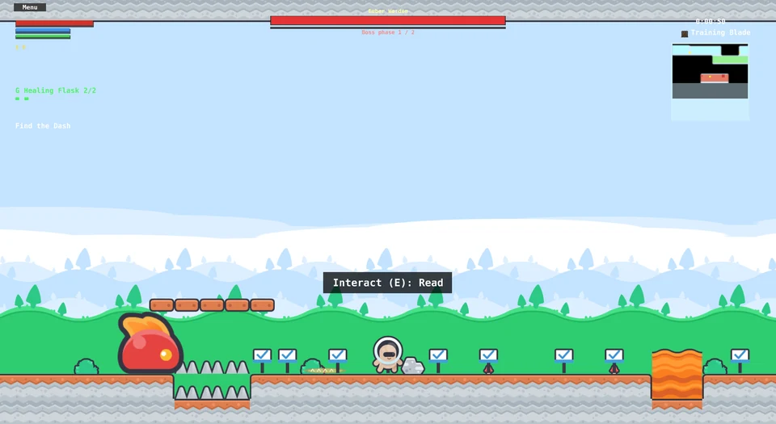
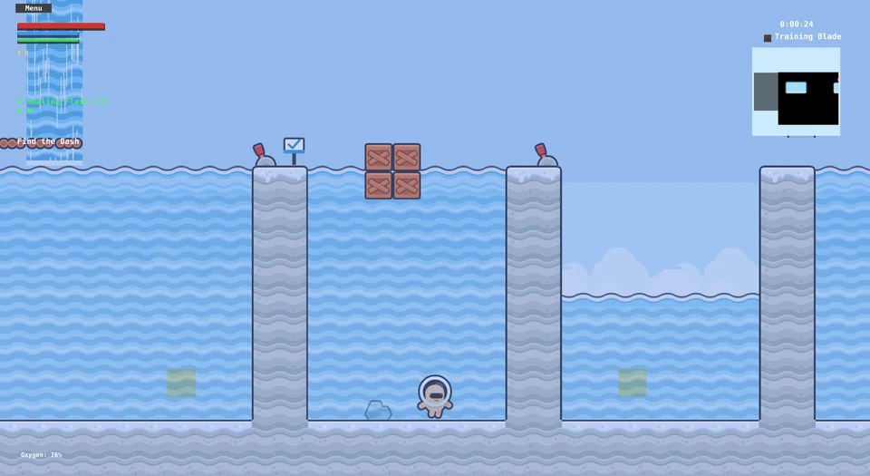
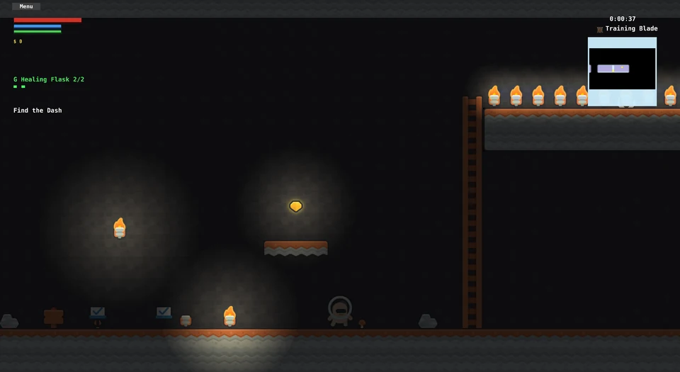

# Metroidvania Toolkit for Defold

Metroidvania Toolkit helps you make exploration platformers in Defold. Paint rooms and place gameplay objects in Tiled, connect the rooms in the Layout Editor, and tune your game in Game Settings. Get the toolkit from the Releases page below.

The toolkit starts empty so you can bring your own art and rooms. A separate showcase world lets you try its systems before building your own game.

## Download

Download the toolkit ZIP and one sample-worlds ZIP containing only the showcase world from
[Releases](https://github.com/schlista/Metroidvania-Toolkit/releases).
The two ZIPs are listed beside each other. Follow the showcase pack's `START_HERE.txt` to use it with the toolkit.

## What you need

- Defold **1.14.1**
- Tiled **1.12.2**
- Windows is the verified platform. macOS and Linux use the same steps but are experimental.

## Start here

1. Open [START_HERE.html](START_HERE.html) in a browser for the illustrated tool setup.
2. Follow [Start here — make three rooms, then play](docs/CREATOR_WORKFLOW.html#start-here-make-three-rooms-then-play) in the Creator Guide.

There is no Windows installer. **Project ▸ Set Up This Toolkit** in Defold sets up the unzipped project and writes `WHERE_THINGS_ARE.txt` with its paths. Keep your original Tiled maps and art outside the toolkit folder; export copies into it.

## What the toolkit does

Find recipes and settings in the Creator Guide's [What the toolkit can do](docs/CREATOR_WORKFLOW.html#what-the-toolkit-can-do) index.

- Build a connected world with regions, maps and [fast travel](docs/CREATOR_WORKFLOW.html#fast-travel-network-and-rules).
- Give players [movement abilities](docs/CREATOR_WORKFLOW.html#add-an-ability-pickup-and-gate) that open new routes through your rooms.
- Shape how the player moves with [movement feel templates](docs/CREATOR_WORKFLOW.html#try-a-movement-feel-template), then tune jumps, braking and falls in one tab.
- Make [switch puzzles and shortcuts](docs/CREATOR_WORKFLOW.html#make-a-shortcut), and change objects or terrain as the story advances.
- Tune [player attacks](docs/CREATOR_WORKFLOW.html#tune-an-attack), energy costs and healing to shape your combat.
- Give enemies different behaviours and build [boss encounters](docs/CREATOR_WORKFLOW.html#build-a-compact-boss-encounter), waves and combat trials.
- Reward exploration with equipment, crafting and [shops](docs/CREATOR_WORKFLOW.html#add-a-shop) where players spend what they find.
- Tell stories through dialogue, cutscenes and [quests](docs/CREATOR_WORKFLOW.html#make-a-quest) with tracked goals.
- Shape each area's atmosphere with [music, lighting and effects](docs/CREATOR_WORKFLOW.html#add-ambience-particles-camera-and-screen-effects).
- Offer [accessibility choices](docs/CREATOR_WORKFLOW.html#accessibility), remappable controls and translated text.
- Choose save rules, difficulty and [endings](docs/CREATOR_WORKFLOW.html#prepare-publish-and-finish-a-game), with optional New Game+ and title-screen extras.

**Project ▸ Game Settings… ▸ Game ▸ Difficulty** chooses whether players pick a difficulty on a new game, use a fixed profile, or can change it during play. Profile labels and multipliers live in `developer/config/difficulty_settings.lua`; first-use hints live in `developer/config/tutorial_popups.lua`. See [difficulty and first-use hints](docs/CREATOR_WORKFLOW.html#keep-dash-difficulty-and-first-use-hints).

After changing rooms, stop the game and choose **Project ▸ Reload Editor Scripts**, **Project ▸ Prepare & Check**, then **Project ▸ Build**. Connect rooms in the title screen's **Layout Editor** and click **Export** before **Play Game**. The [template reference](tiled/templates/README.html) explains each placeable object's properties.

## Known limitations

- Vector text, the default, cannot be drawn on OpenGL ES 2 or WebGL 1 devices. Game Settings ▸ Languages ▸ Text rendering ▸ Distance field runs everywhere.
- macOS and Linux are experimental. On Linux, use Tiled's AppImage or a normal distribution package;
  Flatpak and Snap builds may need different extension paths and permissions. On macOS, say whether
  your Defold is the Apple Silicon (`arm64`) or Intel (`x86_64`) build when you report a problem.
- The sprite player is the supported player. Spine is an optional add-on
  (**Project ▸ Spine Add-on...**) and needs your own Spine Editor license.
- Saves are not guaranteed to load in a newer toolkit version. Each version's [release notes](CHANGELOG.md) say whether to start a new save slot.

## Report a problem

Report problems on the toolkit's [issue tracker](https://github.com/schlista/Metroidvania-Toolkit/issues). Include your operating system,
the Defold and Tiled versions, the START_HERE or Creator Guide step, what you expected and what
happened, and the first red `[ERROR]` line from Defold's Console. The Creator Guide's troubleshooting
section lists what else helps.

## Folder map

| Path | Purpose |
| --- | --- |
| `developer/` | Your game assets, configuration, Tiled exports, generated rooms, and UI |
| `tiled/` | Tiled extensions, custom property types, and the live template catalog |
| `mvtk/` | Toolkit framework; creators should not edit it |
| `hooks/` | The toolkit's Defold editor commands (the Project menu items) |
| `installer/` | Setup and path helpers used by the toolkit; no Windows installer |
| `START_HERE.html` | Illustrated setup guide |
| `docs/CREATOR_WORKFLOW.html` | Creator Guide with recipes and settings |
| `tiled/templates/README.html` | Property-by-property template reference |
| `tools/` | Command-line helpers for validation, previews and the Tiled export path |

## License

Free for personal, non-commercial use. Selling or monetizing a game made with the toolkit requires a paid Commercial License, one per person: [buy one on itch.io](https://schlista.itch.io/metroidvania-toolkit-commercial-license). Terms: [`COMMERCIAL_LICENSE.txt`](COMMERCIAL_LICENSE.txt) and [`LICENSE`](LICENSE). Questions: MVTK@swishermail.com. The included art, music and sound are for demonstration only; replace them before you release a game.
